# 🚀 Awesome-AI-Software-Development-Autonomous-Engineering

  

  
  
  
  
  
  

---

## 🌟 Top AI Software Development & Autonomous Engineering Ecosystem

> **The Curated Catalog of Frontier SaaS Platforms & Open-Source Autonomous AI Coding Agents**  
> *Dedicated to Issue-to-PR Workflows, Parallel Orchestrators, Sandboxed Environments & SWE-bench Benchmarks*  
> 📅 **Last updated: November 2026**

This repository tracks cutting-edge **SaaS platforms** and **open-source projects** defining **AI Software Development & Autonomous Engineering**. These systems act as autonomous software engineers capable of planning architectural designs, navigating multi-million line codebases, executing test suites in sandboxed containers, analyzing live browser sessions, and authoring verified pull requests.

**Key Ecosystem Highlights**:
- 🏢 **Enterprise SaaS Leaders**: Devin (Cognition AI), GitHub Copilot & Workspace, Replit Agent, Factory AI (Droids), Poolside, Augment Code, and Magic.dev.
- 💻 **Open-Source Coding Agents**: OpenHands, Cline, Roo Code, Aider, OpenCode, block/goose, MetaGPT, ChatDev, GPT Pilot, and SWE-agent.
- ⚡ **Agent Infrastructure & Sandboxes**: E2B MicroVMs, Firecracker, Ollama, vLLM, and LiteLLM.

---

## 📑 Table of Contents

- [📊 Sector Overview & Market Dynamics](#-sector-overview--market-dynamics)
- [🏢 SaaS/Hosted Platforms](#-saashosted-platforms)
- [💻 Open-Source GitHub Projects](#-open-source-github-projects)
- [🤝 How to Contribute](#-how-to-contribute)
- [📈 Star History](#-star-history)
- [💖 Support](#-support)
- [📜 Disclaimer](#-disclaimer)

---

## 📊 Sector Overview & Market Dynamics

The global market for AI software engineering and autonomous coding agents is expanding at an accelerated trajectory, rapidly growing from a ~$1 billion direct tooling market toward an estimated **$15+ billion by 2030** as enterprises transition from passive code completion to multi-step autonomous execution. 

The sector currently exhibits a **barbell dynamic**: heavily concentrated at the top tier among hyper-capitalized platform providers and foundation agent labs (e.g., Microsoft/GitHub, Cognition, Poolside, Replit), while remaining intensely fragmented across mid-market specialized orchestration engines, domain-specific coding workflows, and community-driven open-source ecosystems.

---

## 🏢 SaaS/Hosted Platforms

| 🛠️ Platform | 💰 Valuation / Company Size | 💳 Pricing | 🎁 Free Tier Limits | 📝 Description |
| :--- | :--- | :--- | :--- | :--- |
| **[GitHub Copilot & Copilot Workspace](https://github.com)** | Parent: Microsoft ($3.1T+ Market Cap) / $15B+ ARR (GitHub/Cloud Dev) | Pro starts at $10/user/month ($100/yr); Copilot Business at $19/user/month; Copilot Enterprise at $39/user/month | **Free forever plan**: Capped at 2,000 code completions per month and 50 chat messages/agent turns per month. Unlimited code completions require paid tier. | Native GitHub autonomous coding agent and issue-to-PR planning environment capable of drafting specifications, editing multi-file repositories, running CI checks, and opening pull requests. |
| **[Devin (Cognition AI)](https://devin.ai)** | $48B Valuation ($1B ARR run rate) | Pro tier starts at $20/month; Max tier at $200/month; Teams at $80/month base + compute units | **Free forever plan**: Light tier with basic code completions and inline edits only; autonomous cloud agents require paid tiers or custom enterprise pilots (no free autonomous agent runs). | Autonomous AI software engineer equipped with its own cloud shell, code editor, and browser to plan, build, debug, and deploy full-stack engineering tasks from Slack, Jira, or GitHub issues. |
| **[Poolside](https://poolside.ai)** | $12B–$13B Valuation ($50M+ ARR) | Enterprise private VPC licenses starting at custom quote (disclosed enterprise licensing tranches up to $6B) | **No free tier forever**: Evaluation strictly via enterprise sales-assisted POC demo environments; smaller Laguna foundational models released as open-weights for local testing. | Enterprise AI foundation-model and autonomous software development platform trained with reinforcement learning from code execution feedback (`RLCEF`) for private VPC deployments. |
| **[Replit Agent](https://replit.com)** | $9B Valuation ($400M+ ARR) | Core tier starts at $20/month ($18/month billed annually); Pro tier at $100/month ($90/mo annual) | **Free forever plan (Starter)**: 0.5 vCPU, 512MB RAM, 1GB storage, 1 active published app (sleeps after 5 mins inactivity), and tight daily AI agent message caps (resets daily). | Cloud-based collaborative IDE and autonomous software creation agent capable of architecting, coding, debugging, configuring databases, and deploying full-stack web apps from prompts. |
| **[Factory AI (Droids)](https://factory.ai)** | $5B Valuation ($400M+ funding) | Pro starts at $20/month; Plus at $100/month; Max at $200/month; Teams at $60/month base + $40/seat/month | **Free forever plan**: $0 forever for Bring Your Own Inference (BYOI) connecting personal LLM API keys; Factory managed inference requires Pro tier ($20/mo) or prepaid credit pack ($10 min). | Enterprise autonomous software development platform deploying specialized AI "Droids" across coding, code review, testing, incident response, and documentation pipelines. |
| **[Magic.dev](https://magic.dev)** | $1.5B Valuation ($460M+ funding) | Developer API and enterprise tiers starting at custom quote | **Free trial**: Pre-release developer API sandbox access upon approval/onboarding waitlist; no permanent unmetered free tier. | Frontier AI software engineering research and cloud platform building ultra-long-context (`100M+` token LTM) models for repository-scale autonomous code synthesis and reasoning. |
| **[Augment Code](https://augmentcode.com)** | $977M Valuation ($20M ARR) | Standard / Indie starts at $20/month; Team & Business tiers start at $60–$100/month per seat | **Free trial**: 14-day free trial with introductory starting usage credit pool (requires valid payment registration); no permanent free tier. | Enterprise AI software engineering platform featuring a real-time semantic context engine and autonomous cloud agents engineered for massive multi-million-line monorepos. |
| **[Sweep AI / Tembo](https://tembo.io)** | Sweep AI: $25M Valuation; Tembo: Seed / Early-stage | Sweep starts at $10/month (Basic) & $20/month (Pro); Tembo Pro starts at $60/month, Max at $200/month | **Free tier / Free trial**: Sweep provides a free tier with 1,000 autocompletes and $5 introductory API credits; Tembo offers a free trial with sandbox access (up to XL) and usage allowance up to 10 users. | Cloud autonomous engineering background agents that continuously monitor repositories, Sentry errors, and issue trackers to proactively generate tested bug-fix pull requests. |
| **[Cosine (Genie)](https://cosine.sh)** | $8M+ Funding raised / Early Venture | Starter starts at $19/month (4M task credits); Team at $199/month (47M credits); Enterprise at $999/month | **No free tier forever**: Evaluation requires subscribing to the entry Starter tier ($19/mo) or scheduling a tailored enterprise compliance pilot. | Autonomous AI software engineering platform trained on human developer reasoning trajectories to solve complex bug fixes, feature builds, and large-scale refactors. |
| **[OpenHands Cloud (All Hands AI)](https://all-hands.dev)** | $5M Seed Funding ($25M–$30M est. valuation) | Commercial Teams starts at $500/month (includes 10 users, $50/user thereafter); Enterprise custom quote | **Free forever (Open Source MIT)**: 100% free locally or on self-hosted VMs with Bring Your Own Key (BYOK); Commercial cloud and team platform provides a **30-day free trial**. | Managed cloud hosting for the open-source OpenHands autonomous software-engineering platform providing instant sandboxed workspaces and GitHub/GitLab issue automation. |

---

## 💻 Open-Source GitHub Projects

*Sorted by GitHub Stars_Count in descending order. Stars_Badges dynamically link to each repository's stargazers.*

1. **[Superpowers (`obra/superpowers`)](https://github.com/obra/superpowers)**   
   Core engineering skill trees and composable development workflows providing autonomous coding agents with standardized Plan -> Work -> Review -> Compound pipelines and test-driven development (TDD) harness loops.

2. **[OpenCode (`anomalyco/opencode`)](https://github.com/anomalyco/opencode)**   
   Modern open-source (`MIT`) terminal-native AI software engineering agent featuring a rich TUI, LSP diagnostics integration, client/server architecture, and multi-provider LLM support.

3. **[AutoGPT (`Significant-Gravitas/AutoGPT`)](https://github.com/Significant-Gravitas/AutoGPT)**   
   Pioneering autonomous agent architecture featuring recursive self-direction, automated multi-step task execution, memory systems, and modular block execution for end-to-end software automation.

4. **[Ollama (`ollama/ollama`)](https://github.com/ollama/ollama)**   
   The standard open-source framework for running state-of-the-art coding LLMs (`Qwen-Coder`, `DeepSeek-Coder-V2`, `Devstral`, `Llama-3`) locally with GPU acceleration behind autonomous developer agents.

5. **[OpenAI Codex CLI (`openai/codex`)](https://github.com/openai/codex)**   
   Official open-source terminal coding agent from OpenAI with OS-level sandboxing (`Seatbelt`/`Landlock`), multimodal inputs, and MCP server extensibility for deep repository changes.

6. **[Browser Use (`browser-use/browser-use`)](https://github.com/browser-use/browser-use)**   
   Autonomous web browser automation agent enabling software development agents to navigate live web apps, inspect DOM trees, verify UI/UX renders, and perform automated end-to-end visual tests.

7. **[Google Gemini CLI (`google-gemini/gemini-cli`)](https://github.com/google-gemini/gemini-cli)**   
   Official open-source command-line coding agent harnessing 1M+ token context windows for full-codebase ingestion, terminal debugging, and automated code refactoring.

8. **[vLLM (`vllm-project/vllm`)](https://github.com/vllm-project/vllm)**   
   High-throughput, low-latency LLM serving engine featuring PagedAttention, powering high-concurrency coding agent clusters and sovereign AI software engineering teams.

9. **[OpenHands (`All-Hands-AI/OpenHands`)](https://github.com/All-Hands-AI/OpenHands)**   
   Flagship open-source (`MIT`) autonomous AI software engineer operating inside Dockerized sandboxes equipped with terminal bash execution, code editing, web browsing, and GitHub issue-to-PR pipelines.

10. **[Cline (`cline/cline`)](https://github.com/cline/cline)**   
    Autonomous VS Code software engineering extension that creates and edits multi-file projects, runs terminal commands, analyzes compiler feedback, and handles MCP external tools directly from the editor.

11. **[MetaGPT (`geekan/MetaGPT`)](https://github.com/geekan/MetaGPT)**   
    Multi-agent software company framework (`MIT`) encoding Standard Operating Procedures (SOPs) into specialized roles (Product Manager, Architect, Project Manager, Engineer, QA) to generate full software projects from one prompt.

12. **[AnythingLLM (`Mintplex-Labs/anything-llm`)](https://github.com/Mintplex-Labs/anything-llm)**   
    Full-stack developer knowledge retrieval, workspace indexing, and autonomous agent platform with built-in multi-user management, document parsing, and local LLM orchestration.

13. **[LiteLLM (`BerriAI/litellm`)](https://github.com/BerriAI/litellm)**   
    Universal AI gateway and proxy allowing autonomous coding agents to call 100+ LLM APIs (Anthropic, OpenAI, Bedrock, Vertex, Ollama, vLLM) using unified OpenAI-compatible formatting with load balancing and fallbacks.

14. **[Goose (`block/goose`)](https://github.com/block/goose)**   
    Extensible open-source (`Apache-2.0`) local-first autonomous developer agent from Block supporting end-to-end project scaffolding, code execution, debugging, and Model Context Protocol (MCP) toolkits.

15. **[GPT Engineer (`AntonOsika/gpt-engineer`)](https://github.com/AntonOsika/gpt-engineer)**   
    Autonomous software generation CLI that asks clarifying architectural questions before constructing entire codebases and generating production-ready Git repositories.

16. **[Aider (`Aider-AI/aider`)](https://github.com/Aider-AI/aider)**   
    Pioneering open-source (`Apache-2.0`) terminal AI pair-programming and autonomous refactoring agent that maps entire Git repositories, runs linters/tests, and commits clean changes.

17. **[Firecracker MicroVM (`firecracker-microvm/firecracker`)](https://github.com/firecracker-microvm/firecracker)**   
    Minimalist open-source virtualization technology created by AWS, providing ultra-lightweight, hardware-isolated MicroVM sandboxes for running untrusted autonomous agent-generated builds safely.

18. **[Continue (`continuedev/continue`)](https://github.com/continuedev/continue)**   
    Open-source AI code assistant for VS Code and JetBrains, connecting models to codebase context, inline edits, and customizable agent slash commands.

19. **[ChatDev (`OpenBMB/ChatDev`)](https://github.com/OpenBMB/ChatDev)**   
    Open-source (`Apache-2.0`) virtual software engineering organization powered by communicating LLM agents collaborating across design, coding, code review, testing, and documentation phases.

20. **[GPT Pilot / Pythagora (`Pythagora-io/gpt-pilot`)](https://github.com/Pythagora-io/gpt-pilot)**   
    Step-by-step open-source (`Apache-2.0`) AI developer tool that writes production-ready full-stack applications incrementally while debugging errors and asking for human architecture feedback.

21. **[Serena (`oraios/serena`)](https://github.com/oraios/serena)**   
    Language Server Protocol (LSP) integration agent providing autonomous coding assistants with deep AST semantic graph understanding, find-references, and type-checked symbol refactorings.

22. **[Qwen Code (`QwenLM/qwen-code`)](https://github.com/QwenLM/qwen-code)**   
    Official open-source (`Apache-2.0`) agentic command-line coding workflow from Alibaba Qwen optimized for `Qwen-Coder` with repository-scale understanding and automated refactoring.

23. **[Tree-sitter (`tree-sitter/tree-sitter`)](https://github.com/tree-sitter/tree-sitter)**   
    Incremental parsing system used across autonomous software engineering harnesses to build concrete syntax trees for ultra-accurate multi-file code editing and patch validation.

24. **[Compound Engineering Plugin (`EveryInc/compound-engineering-plugin`)](https://github.com/EveryInc/compound-engineering-plugin)**   
    Structured compounding development plugins establishing rigorous review, systematic planning, and continuous improvement loops for AI coding agents.

25. **[Roo Code (`RooCodeInc/Roo-Code`)](https://github.com/RooCodeInc/Roo-Code)**   
    Popular community-driven fork of Cline with advanced multi-model switching, Boomerang sub-task delegation, custom agent modes (Architect, Code, Ask), and checkpoint diff verification.

26. **[Skyvern (`Skyvern-AI/skyvern`)](https://github.com/Skyvern-AI/skyvern)**   
    Computer-vision and LLM-driven browser automation agent that automates complex UI workflows, SaaS portal logins, and visual quality assurance for software engineers.

27. **[SWE-agent (`SWE-agent/SWE-agent`)](https://github.com/SWE-agent/SWE-agent)**   
    Leading open-source (`MIT`) autonomous GitHub issue resolution agent from Princeton NLP equipped with custom Agent-Computer Interfaces (ACI) for repository navigation, editing, and patch verification.

28. **[Devika (`stitionai/devika`)](https://github.com/stitionai/devika)**   
    Open-source (`MIT`) agentic AI software engineer inspired by Devin that breaks down high-level instructions into research steps, contextual code synthesis, and browser verification.

29. **[CAMEL (`camel-ai/camel`)](https://github.com/camel-ai/camel)**   
    Communicative agent framework providing role-playing multi-agent cooperative software development algorithms to explore autonomous agent reasoning and code collaboration.

30. **[SuperAGI (`TransformerOptimus/SuperAGI`)](https://github.com/TransformerOptimus/SuperAGI)**   
    Infrastructure framework for building, managing, and running autonomous agent swarms with action console execution, telemetry, and vector store connectors.

31. **[PR-Agent / Qodo Merge (`qodo-ai/pr-agent`)](https://github.com/qodo-ai/pr-agent)**   
    Automated AI pull request walkthroughs, code review feedback, security bug detection, and unit test generation integrated directly into GitHub, GitLab, and Bitbucket CI/CD.

32. **[Paradev (`ParadevAI/Paradev`)](https://github.com/ParadevAI/Paradev)**   
    Open-source parallel autonomous software development and engineering orchestration platform designed to run, coordinate, and manage concurrent AI coding agents across isolated Git worktrees and tasks.

33. **[Plandex (`plandex-ai/plandex`)](https://github.com/plandex-ai/plandex)**   
    Open-source (`AGPL-3.0`) terminal-based AI development engine engineered for large, multi-file tasks with sandboxed cumulative diffs, versioned plan branches, and automated context loading.

34. **[E2B Sandbox (`e2b-dev/E2B`)](https://github.com/e2b-dev/E2B)**   
    Secure, isolated cloud micro-virtual-machines providing coding agents with ephemeral Linux environments to run arbitrary code, start servers, and execute test suites safely.

35. **[SWE-bench (`SWE-bench/SWE-bench`)](https://github.com/SWE-bench/SWE-bench)**   
    Industry-standard open-source (`MIT`) benchmark suite evaluating autonomous software-engineering agents on their ability to resolve real-world GitHub issues inside Dockerized repositories.

36. **[E2B Code Interpreter (`e2b-dev/code-interpreter`)](https://github.com/e2b-dev/code-interpreter)**   
    Open-source SDK providing autonomous agents with a secure Python and Bash sandbox to execute generated scripts, analyze data, and return chart/log outputs.

37. **[RA.Aid (`ai-christianson/RA.Aid`)](https://github.com/ai-christianson/RA.Aid)**   
    Open-source (`Apache-2.0`) LangGraph-powered autonomous software engineering CLI utilizing a three-stage Research, Planning, and Implementation workflow for complex repositories.

---

## 🤝 How to Contribute

Contributions are welcome! Please follow these guidelines:
1. 🍴 Fork the repository.
2. 🌿 Create a new feature branch (`git checkout -b feature/add-new-agent`).
3. 📝 Add factual entries linking directly to project sites or repositories.
4. 🚀 Open a Pull Request with a clear summary of the additions.

---

## 📈 Star History

---

## 💖 Support

Thank you for visiting and supporting the **Awesome AI Software Development & Autonomous Engineering** ecosystem! 

If you find this repository helpful, please consider:
- ⭐ **Starring** the repository on GitHub
- 🍴 **Forking** it to keep your own copy updated
- 📢 **Sharing** it with developers, researchers, and AI builders

You can also support the ongoing maintenance and curation of this project by sponsoring or buying a coffee:  
👉 **[Sponsor Dashboard / Buy a Coffee](https://github.com/sponsors/ishandutta2007)**

---

## 📜 Disclaimer

This curated list is provided for educational and informational purposes only. Product names, logos, and brands are property of their respective owners. Listing does not imply official endorsement.
